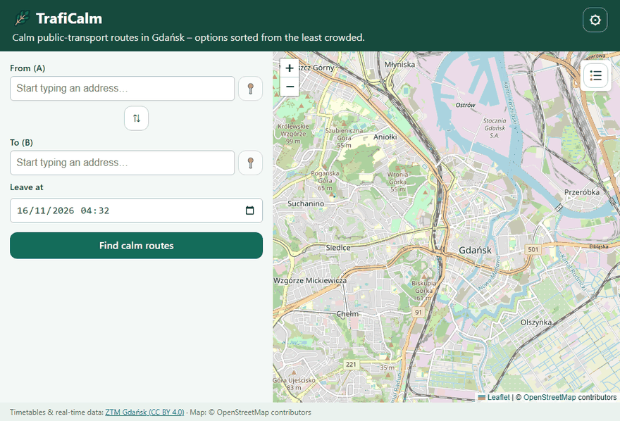

# 🌿 TrafiCalm

TrafiCalm is a journey planner for people who suffer from agoraphobia or simply want to avoid crowds.
It plans public-transport journeys from **A** to **B** in **Gdańsk, Poznań, Wrocław or Warsaw**, estimates a
**crowd index (0–100 %)** for every option and lists the options **from the least crowded**. When a
route passes through a very busy place (e.g. the main station or the city centre) it also suggests
variants that board/alight at quieter stops and walk around the crowded part.



| Layer | Technology |
| --- | --- |
| Frontend | React + TypeScript (Vite), Leaflet / react-leaflet with OpenStreetMap tiles |
| Backend | Python, FastAPI (REST API), SQLAlchemy |
| Database | PostgreSQL or SQLite, with an independent database for each city |
| Transit data | City-specific GTFS; official Gdańsk/Poznań/Wrocław feeds and a community conversion of ZTM Warszawa data |
| Geocoding / walking | OpenStreetMap Nominatim (address suggestions) and OSRM foot routing |
| Crowd model | Built-in rule-based model, optionally blended with the open-source [Laya](https://github.com/NandhaKishorM/laya) decision model |

## Features

* **City selection** – choose Gdańsk, Poznań, Wrocław or Warszawa in Settings. The first selection automatically downloads the timetable; loading, failures and retry are visible. Switching cities clears the old addresses and journey.
* **Point A and B** – address suggestions are limited to the selected city itself, not nearby towns. **Use GPS** is off by default; enable it in Settings to show your position and use the 📍 address buttons. Disabling GPS stops location watching.
* **Transport options** – direct and one-transfer connections, with a two-transfer fallback when neither finds usable transit, plus a walking-only option for short trips.
  Connections invalidated by actual walking time are excluded; access walks cannot start before the requested departure.
* **Crowd index** for each option, each ride and each stop, with the reasons (rush hour, near the main station, large event nearby…).
* **Sorted by crowd index**, lowest first.
* **Crowd-avoiding variants** – if a ride goes through a location with a high crowd index, TrafiCalm tries to board later / get off earlier at quieter stops, or to split the ride and walk around the crowded section.
* **Crowd tolerance** – defaults to 60%, is saved in your browser, and highlights stop visits exceeding your chosen threshold. Existing saved values are preserved.
* **Manual route alternatives** – click a stop to reveal controls underneath it. **Avoid stop** opens an inline editor: remove the stop entirely, or choose where to get off and a nearby boarding stop. Confirm an alternative before the map changes.
* **Walking logic** – **Fastest** ignores every crowd rule (no crowd-avoiding variants, no Laya) and ranks routes by earliest arrival. **Flexible** (default) is the standard planner. **Strict** automates "Avoid stop → Remove stop and replan": it plans, and if the best route has a walk through a high or very high crowded area (50%+), it removes the stop that walk starts from, replans the whole journey once, and returns the merged results ranked by crowd (long walk-only routes are dropped when transit exists). It also keeps every walking leg out of crowd-map areas rated high or very high (50%+, regardless of your crowd tolerance) when you pick alternative stops (detouring around them, or dropping journeys that cannot avoid them), so results may be longer or fewer. Only walking is checked, using the crowd forecast at departure time; detours without a routable footpath are estimated and flagged.
* **Optional Laya scoring** – **Use Laya AI** is off by default, with a saved per-user opt-in and explicit feedback when the model is unavailable.
* **Settings menu** – the gear opens city, GPS, English/Polish language, Dark Mode, walking-radius, crowd-tolerance, Laya and time-slider settings. Full-width sliders and switch-style toggles use the shared light/dark palette. Preferences are saved in your browser.
* **Stop list** with scheduled times and real-time adjustments (delays from GTFS-RT, refreshed every 30 s).
* **Map** (OpenStreetMap) with the transit legs (coloured by crowd index), dashed walking legs, stops, live vehicle positions and your GPS position.
* **Predicted crowded areas** – time-of-day, seasonal and event-based area colours near your route. High-crowd areas remain visible even without a selected journey.
* **60-minute forecasts** – crowd demand shifts and timetable-based vehicle positions for the following hour. An optional, centred map slider explores the next 24 hours.
* **Selected-trip live tracking** – only buses assigned to selected scheduled trips, with service-date matching and a 120-second freshness limit. Tracking and forecasts refresh when you confirm a new route.

### Altering a planned journey

Address suggestions use the selected city's locality in OpenStreetMap; Gdańsk suggestions exclude
other Tricity municipalities. Transit, GPS and map coverage retain their configured city-region bounds.
Set **Crowd tolerance** in **Settings** before planning. Stops strictly above that percentage show a warning;
changing the setting updates highlights without replacing the selected journey.

Click any transit stop in the list or on the map to reveal its inline controls.
For a stop above tolerance, a prompt appears immediately below the stop:
**Yes, show avoidance options** opens the editor immediately, while **Keep this stop** dismisses
the prompt. There is no second **Avoid stop** confirmation after accepting the prompt.
Below-tolerance stops reveal **Avoid stop** directly when clicked.

* **Remove stop and replan whole journey** searches from the original endpoints and departure,
  excluding selected stops and their 100 m surroundings from walking and transit geometry.
* Alternatively, choose **Where to get off**: up to three immediately preceding stops on the
  selected journey (including previous transit legs), or the selected stop itself. Each **before**
  label names the next stop on that journey, not necessarily the stop being avoided.
  Exit choices follow route order, not geographic proximity. Choose another boarding stop from the nearest-first list within
  the configured straight-line radius of your exit point (**0.5 km by default**). Walking can be longer.
  Suggested routes appear directly below the chosen new stop. The timetable-based journey
  to the exit point is retained; a walking connection and onward transport replace the rest.
  Onward departures account for walking time, the transfer buffer and reported exit delays.
  Onward transit must board at the chosen stop and cannot visit previously excluded stops.
  If you choose to get off at the selected crowded stop, visiting it once is intentional;
  it is excluded from onward transit, not from the retained part or your walk.

Select a suggested route, then click **Confirm new route** to update the journey and map.
Nearby alternatives appear as temporary map dots. Hovering or focusing a stop enlarges its dot;
leaving restores its size. Confirmation, keeping the current route, or closing/changing the editor
removes the preview dots. The themed exit selector distinguishes stop visits across transit legs.
If a stop's onward search returns no routes, that stop is removed from the list and map previews,
with an explanation. A network/service error does not incorrectly classify a stop as unreachable.
Saved walking-radius preferences remain honoured; new settings default to 0.5 km.
Selecting a card alone does not replace your journey. If no valid route is found, choose
another boarding/exit stop; your current journey stays unchanged. Errors and loading appear
inline, including a CPU-scoring latency notice when Laya is enabled.
Use **Keep current route** to dismiss the editor; submit a new journey to clear excluded stops.
Options are not guaranteed to be below your tolerance: compare crowd levels and walking distances.

Open the **Settings gear** in the header to change the app language (**English / Polish**) and
**Dark Mode**. **Walking distance cap (km)** controls the nearby-stop search radius,
not total walking distance or the footpath length. It accepts 0.1–20 km in 0.1 km steps.
Changing this cap closes any open stop editor; the new radius applies when you start
the next nearby-stop search. It does not silently alter the current route.
Interface text, stop-editing controls, map legends and standard crowd explanations are localized;
place names, imported event names and unrecognized external-service text retain their source language.
Crowd tolerance and **Use Laya AI** live in this menu, not the planning form.
Laya is **off by default**; a previously saved explicit opt-in remains honoured.
On narrow screens, the map fills the view and the journey planner is a collapsible bottom sheet.
Settings also open as a bottom sheet, with large touch targets and switch-style toggles.

### Map forecasts and live vehicles

Crowd polygons have their own low map pane; routes, stops, predicted vehicles and live buses
are drawn in progressively higher panes. Crowd areas cannot cover or intercept clicks on stops
or buses. The **crowd map legend icon** expands on hover/focus and can be toggled on touch devices.
The icon becomes a text heading while expanded; moving the pointer away collapses it, including after a click.
The **live bus tracking icon** shows its legend on hover or keyboard focus; moving away or
pressing Escape closes it. A badge indicates tracking-status messages, which are also announced
to screen readers while the legend is closed.

Forecasts cover **60 minutes from the planned departure**, or the current clock when no
journey is selected. Purple arrows heuristically match falling and rising rule-based demand
within 3 km using time-of-day profiles, hotspots, busy stops and imported events. They are
**inferred demand shifts, not observed people or verified pedestrian routes**. No arrow is
invented when no suitable declining/increasing pair exists. The area colours show predicted
crowd levels at the end of the forecast window.

Enable **Show forecast time slider** in Settings to reveal the centred bottom-of-map slider.
It explores offsets from 0 to 24 hours in 15-minute steps. Both crowd and scheduled-vehicle
forecasts use the selected window; live GPS remains current regardless of slider position.
Changing the selected route resets the forecast offset.

Dotted vehicle rings are **timetable estimates**, sampled through the next hour and constrained
to the boarding/alighting section of each selected trip; fresh applicable delays are included.
They are not labelled live GPS. Real bus markers use only selected trip IDs and matching
service dates. Missing, stale or unavailable positions are reported explicitly, never replaced
by simulated live buses. Requests from the previous route are cancelled and ignored.
When a feed omits the service date, positions must fall within the selected trip's scheduled
run window (including overnight service), rather than matching only its trip ID.
Malformed explicit service dates and invalid coordinates are logged and discarded.

### Colour scheme

| Token | Light | Dark |
| --- | --- | --- |
| Page | `#F3F8F6` | `#101C21` |
| Surface | `#FFFFFF` | `#192C32` |
| Primary action | `#146C5A` | `#71D5B8` |
| Text | `#18362F` | `#E2F0E9` |
| Muted text | `#526D65` | `#AFC8BE` |

Buttons share rounded corners, focus outlines, hover colours and primary/secondary variants.
Crowd bands and agency line colours retain their distinct semantic meanings.
Walking geometry is an estimate if the foot router is unavailable, not a verified footpath.
Avoidance searches allow walking transfers up to the configured avoidance distance
(default 1,500 m straight-line), including walking to the next usable stop and boarding
a different line. Alternative cards show these walking/boarding steps.

Map colours use the existing crowd bands: low (0–24%), moderate (25–49%), high (50–74%),
very high (75–100%). High/very-high areas are always shown in the map view; other areas are
clipped to the 500 m corridor around the selected route. Adjacent/overlapping areas in
the same crowd band are dissolved into connected polygons, preserving holes; higher
crowd bands take precedence rather than being hidden underneath lower bands. Predictions use the
forecast window, refresh every minute and when the map moves, and are **not live
crowd measurements**. These overlays cover Tricity using a bounded, adaptive grid plus
known hotspots, active imported events and busy stops; they are approximate area estimates.
Areas are displayed for awareness; routing excludes only explicitly selected stops, not
every coloured area.

## Quick start (Docker)

```bash
docker compose up --build
```

* Web app: <http://localhost:8080>
* API docs (OpenAPI/Swagger): <http://localhost:8000/docs>

On the first start the backend downloads the ZTM Gdańsk GTFS timetable and imports it into PostgreSQL
(this takes a few minutes). To refresh the timetable later:

```bash
docker compose exec backend python -m app.cli load-gtfs
docker compose restart backend   # the in-memory routing index is built at start-up
```

Optional: import large local events (stadium matches, concerts, fairs…) used by the crowd model:

```bash
docker compose exec backend python -m app.cli import-events data/events.example.json
```

### With the Laya AI decision model

[Laya](https://github.com/NandhaKishorM/laya) (Apache-2.0) is served by its `laya-serve` HTTP server.
Docker Compose starts the CPU-based English Laya service by default and connects the backend
to it. The first start downloads its model weights. **Use Laya AI** is off by default;
users can opt in through Settings. The choice applies to new plans and alternatives,
does not change other users' requests, and is saved in the browser.
When the service cannot score a request, the app explicitly reports rule-based-only
or partial scoring; the Laya badge indicates scores actually used, not just a configured URL.

## Local development

Requirements: Python 3.12+, Node.js 22+, and either PostgreSQL 14+ or SQLite
(included with Python). For a Windows setup without PostgreSQL, use the steps below.

### Windows quick start (PowerShell + SQLite)

Install the prerequisites with Windows Package Manager:

```powershell
winget install --id Python.Python.3.12 --exact --accept-package-agreements --accept-source-agreements
winget install --id OpenJS.NodeJS.22 --exact --accept-package-agreements --accept-source-agreements
```

Restart VS Code or your terminal after installation so it picks up the updated PATH.
From the repository root, create `backend\.env` with this line (or update the setting
if the file already exists):

```dotenv
TRAFICALM_DATABASE_URL=sqlite:///data/traficalm.sqlite3
```

In the first PowerShell terminal, set up and start the local Laya service:

```powershell
cd backend
py -3.12 -m venv .venv-laya
.\.venv-laya\Scripts\python.exe -m pip install torch --index-url https://download.pytorch.org/whl/cpu
.\.venv-laya\Scripts\python.exe -m pip install -r requirements-laya.txt
$env:LAYA_HOST = "127.0.0.1"
$env:LAYA_PORT = "8001"
$env:LAYA_DEVICE = "cpu"
$env:LAYA_MODELS = "english"
$env:LAYA_DEFAULT_MODEL = "english"
$env:LAYA_PRELOAD = "1"
$env:LAYA_THREADS = "2"
.\.venv-laya\Scripts\laya-serve.exe
```

The separate virtual environment avoids mixing model-runtime and backend dependencies.
On first start, Laya downloads the public English checkpoint from Hugging Face; later
starts reuse the local cache. Wait for <http://localhost:8001/health> to report the
English model loaded. Do not treat its estimates as calibrated real crowd measurements.
CPU scoring of many rides can take tens of seconds. Identical ride contexts are scored
once per plan, and forward passes use small batches to limit memory. Opt out in the
Settings when you prefer faster, rule-based-only results.

In a second PowerShell terminal, from the repository root, set up and start the backend:

```powershell
cd backend
py -3.12 -m venv .venv
.\.venv\Scripts\python.exe -m pip install -r requirements-dev.txt
.\.venv\Scripts\python.exe -m app.cli load-gtfs --if-empty
.\.venv\Scripts\python.exe -m uvicorn app.main:app --host localhost --port 8000
```

The first timetable download/import takes a few minutes. The SQLite file persists in
`backend\data\traficalm.sqlite3`; both it and `.env` are ignored by Git.

In a third PowerShell terminal, from the repository root, start the frontend:

```powershell
cd frontend
npm.cmd install
npm.cmd run dev -- --host localhost --port 5173 --strictPort
```

Use `npm.cmd` to avoid PowerShell's script-execution restriction on `npm.ps1`;
no execution-policy change or virtual-environment activation is needed.

* Web app: <http://localhost:5173>
* API docs: <http://localhost:8000/docs>
* Health check: <http://localhost:8000/api/health> (expect `status: "ok"` and nonzero timetable counts)

Keep the three terminals open while using the app. Stop it with **Ctrl+C in each terminal**.
On subsequent starts, run the Laya environment assignments and `laya-serve` command,
then the `uvicorn` and `npm.cmd run dev` commands from their respective directories;
the installation and import steps are not needed again. To refresh the timetable, stop the backend,
run `.\.venv\Scripts\python.exe -m app.cli load-gtfs` from `backend`, then restart it.

### PostgreSQL setup (Bash)

```bash
# database
createuser traficalm --pwprompt        # password: traficalm (or set TRAFICALM_DB_PASSWORD)
createdb traficalm -O traficalm

# backend
cd backend
python -m venv .venv && . .venv/bin/activate
pip install -r requirements-dev.txt
python -m app.cli load-gtfs             # or: --file path/to/gtfs.zip
uvicorn app.main:app --reload           # http://localhost:8000

# frontend (proxies /api to http://localhost:8000)
cd frontend
npm install
npm run dev                             # http://localhost:5173
```

For local development without PostgreSQL, set
`TRAFICALM_DATABASE_URL=sqlite:///data/traficalm.sqlite3` in `backend/.env`.
Skip the PostgreSQL setup, then run the same backend import and startup commands
from the `backend` directory. The SQLite file persists locally and is ignored by Git.

### Tests and checks

```bash
cd backend && python -m pytest -q       # uses an in-memory SQLite DB and a synthetic GTFS feed
cd frontend && npm test && npm run lint && npm run build
```

## Configuration

Backend settings are environment variables with the `TRAFICALM_` prefix (a `backend/.env` file is also read).

### City timetables

Select the city in Settings and wait for its first download/import. Timetables persist between
server restarts; selecting a prepared city reuses its data. An expired feed with a published end
date is refreshed automatically. Wrocław's dated download listing is checked for actual current
validity rather than assuming the first link is usable.

Gdańsk retains `TRAFICALM_DATABASE_URL` (or the PostgreSQL component settings). Other cities
default to separate SQLite files under `backend/data`; their database URLs can instead point
to independently provisioned PostgreSQL databases. Never point multiple cities at the same
database: GTFS stop/trip identifiers overlap between publishers.

To import or refresh manually, run from `backend`:

```bash
python -m app.cli init-db --city warsaw
python -m app.cli load-gtfs --city warsaw
# Or import a local archive:
python -m app.cli load-gtfs --file path/to/feed.zip --city warsaw
```

Use `gdansk`, `poznan`, `wroclaw` or `warsaw`. Restart the backend after a CLI import
so its in-memory index uses the new data. The in-app preparation endpoint refreshes its own
city index without a restart.

Wrocław publishes through **UM Wrocław / MPK**, not ZTM. Warsaw uses the community GTFS
conversion hosted by Mikołaj Kuranowski, with all imported `attributions.txt` credits displayed
in the footer. This is **not an official Warsaw GTFS API** and carries the publisher's
availability disclaimer. Neither city's integration assigns live GPS to selected trips:
Wrocław's public GPS cannot identify them, and Warsaw's community matching is best-effort.
Timetable-based vehicle and crowd forecasts remain available. No API key is needed for these feeds.

| Variable | Default | Description |
| --- | --- | --- |
| `TRAFICALM_DB_HOST` / `_DB_PORT` / `_DB_NAME` / `_DB_USER` / `_DB_PASSWORD` | `localhost` / `5432` / `traficalm` / `traficalm` / `traficalm` | PostgreSQL connection |
| `TRAFICALM_DATABASE_URL` | – | Full SQLAlchemy URL (overrides the values above) |
| `TRAFICALM_GTFS_STATIC_URL` | ZTM Gdańsk GTFS | Static timetable zip |
| `TRAFICALM_GTFS_RT_TRIP_UPDATES_URL`, `TRAFICALM_GTFS_RT_VEHICLE_POSITIONS_URL` | ZTM Gdańsk GTFS-RT | Real-time feeds |
| `TRAFICALM_GTFS_RT_ENABLED` | `true` | Disable real-time lookups |
| `TRAFICALM_POZNAN_DATABASE_URL` | `sqlite:///data/poznan.sqlite3` | Separate Poznań database |
| `TRAFICALM_WROCLAW_DATABASE_URL` | `sqlite:///data/wroclaw.sqlite3` | Separate Wrocław database |
| `TRAFICALM_WARSAW_DATABASE_URL` | `sqlite:///data/warsaw.sqlite3` | Separate Warsaw database |
| `TRAFICALM_POZNAN_GTFS_STATIC_URL` | ZTM Poznań latest GTFS | Static timetable zip |
| `TRAFICALM_POZNAN_GTFS_RT_TRIP_UPDATES_URL`, `TRAFICALM_POZNAN_GTFS_RT_VEHICLE_POSITIONS_URL` | ZTM Poznań GTFS-RT | Official real-time feeds |
| `TRAFICALM_WROCLAW_GTFS_LISTING_URL` | CUI Wrocław dated GTFS listing | Finds a currently valid official feed |
| `TRAFICALM_WROCLAW_GTFS_STATIC_URL` | empty | Optional direct zip overriding listing discovery |
| `TRAFICALM_WARSAW_GTFS_STATIC_URL` | `https://mkuran.pl/gtfs/warsaw.zip` | Community ZTM Warszawa conversion |
| `TRAFICALM_NOMINATIM_URL` | `https://nominatim.openstreetmap.org` | Geocoder (use your own instance for heavy traffic) |
| `TRAFICALM_OSRM_FOOT_URL` | `https://routing.openstreetmap.de/routed-foot` | Walking router |
| `TRAFICALM_WALKING_ROUTER_ENABLED` | `true` | Use straight lines × detour factor instead of OSRM when `false` |
| `TRAFICALM_HIGH_CROWD_THRESHOLD` | `60` | Planner's internal fallback threshold; `/api/plan` uses `crowd_tolerance` (default 60) instead |
| `TRAFICALM_MAX_AVOIDANCE_WALK_M` | `1500` | Longest extra walk used to avoid crowds |
| `TRAFICALM_LAYA_URL` | `http://127.0.0.1:8001` | Local `laya-serve` URL; Docker uses `http://laya:8000`; empty disables it server-wide |
| `TRAFICALM_LAYA_API_KEY` | – | API key sent to `laya-serve` when it is started with `LAYA_API_KEY` |
| `TRAFICALM_LAYA_WEIGHT` | `0.4` | Share of the Laya estimate in the final crowd index |
| `TRAFICALM_LAYA_TIMEOUT_SECONDS` | `60` | Per-HTTP-batch scoring timeout, allowing CPU inference; unavailable scores are reported explicitly |
| `TRAFICALM_HOTSPOTS_FILE` | – | JSON file overriding the built-in list of crowded places |
| `TRAFICALM_POZNAN_HOTSPOTS_FILE`, `TRAFICALM_WROCLAW_HOTSPOTS_FILE`, `TRAFICALM_WARSAW_HOTSPOTS_FILE` | – | Overrides for each city's crowd hotspots |
| `TRAFICALM_ADMIN_TOKEN` | – | Enables `POST/DELETE /api/events` (header `X-Admin-Token`) |
| `TRAFICALM_CORS_ORIGINS` | `*` | Comma-separated allowed origins |

Frontend: `VITE_API_URL` (API base URL for production builds, default: same origin) and
`VITE_API_PROXY` (dev-server proxy target, default `http://localhost:8000`).

## How the crowd index works

For every stop visited at a given time the backend computes these features (each 0–1):

* **Rush hours** – weekday morning (≈7:30) and afternoon (≈16:00) peaks, weaker at weekends and at night.
* **Busy places** – distance to known crowded places: Gdańsk Główny (main station), the Main Town/city centre,
  Wrzeszcz, shopping centres, the stadium, Ergo Arena, the airport… (`backend/app/crowd/hotspots.py`, coordinates are approximate).
  Kind-specific activity profiles account for Friday/Saturday nightlife (including after midnight),
  retail opening hours, daytime/evening city-centre activity and June–August beach demand.
  Venues have low baseline activity; imported events supply their event-specific demand.
* **Large local events** – events stored in the `local_events` table; crowds build up before the start and peak right after the end, scaled by the expected attendance.
* **Heavily used stops and lines** – how many departures serve a stop / a line in the GTFS timetable.

A ride's crowd index combines its stops (busiest part weighs most) with the line usage; walking legs are
weighted lower (outdoors). The itinerary index is `0.6 × worst leg + 0.4 × duration-weighted mean`.
When Laya is enabled, each ride is described to the model in plain language (time, places, events, usage)
and its answer on a 5-level crowd scale (empty → packed) is blended with the rule-based value (`TRAFICALM_LAYA_WEIGHT`).
The planner returns the options sorted by crowd index, then by arrival time.

Stop warnings, automatic avoidance triggers and the crowded-area overlay use the rule-based
model. Laya refines transit-leg scores and consequently itinerary ranking; it does not generate
routes, discover events, modify stop estimates or colour the area polygons. Scoring is
off by default (`use_laya=false`) and can be opted into per request. It requires
a running service at `TRAFICALM_LAYA_URL`. Responses distinguish `used`, `partial`,
`unavailable`, `disabled` and `not-needed` (walking-only); missing scores are not labelled AI-scored.

### Possible free/open data integrations (not enabled)

There is no verified free API providing comprehensive, live Tricity crowd counts or all
protests, marathons, matches and festivals. Current event predictions require importing
events with the CLI or the admin-protected events API.

* [OpenStreetMap / Overpass](https://wiki.openstreetmap.org/wiki/Overpass_API) can supply
  locations/density of pubs, nightclubs, stations and beaches, not their attendance.
  Cache queries, respect shared-instance limits and ODbL attribution/derived-database requirements.
* [Open-Meteo](https://open-meteo.com/en/docs) offers weather context (e.g. beach demand);
  its free hosted API requires no key for non-commercial use.
  [Pricing and limits](https://open-meteo.com/en/pricing) apply; weather is not crowd data.
* [Ticketmaster Discovery API](https://developer.ticketmaster.com/products-and-docs/apis/discovery-api/v2/)
  has a free key-based quota (normally 5,000 requests/day) for ticketed events.
  Tricity coverage needs testing; it is not a comprehensive protest or local-event feed.
* [Gdańsk open transit data](https://ckan.multimediagdansk.pl/en/dataset/tristar) also publishes
  disruption notices, a potential event signal, but not verified passenger crowd counts.

These would provide input signals for estimates, not guaranteed real-time crowd levels.
No additional external integration or API key is required for the current features.

## REST API

City-dependent endpoints accept `city=gdansk|poznan|wroclaw|warsaw` as a query parameter,
defaulting to `gdansk` for compatibility. Prepare the chosen city before planning; missing
transit data returns **503**, not a misleading walking-only success. Continuation JSON also
includes the original plan's `city`; a mismatch is rejected.

| Method & path | Description |
| --- | --- |
| `GET /api/health` | Status and loaded timetable size |
| `POST /api/cities/{city}/prepare` | Download/import if missing or expired, build the city index, and return readiness, validity dates, source/licence and imported attribution credits |
| `GET /api/geocode/search?q=` | Address suggestions within the selected city itself (min. 3 characters) |
| `GET /api/geocode/reverse?lat=&lon=` | Address of a GPS position |
| `GET /api/plan?from_lat=&from_lon=&to_lat=&to_lon=[&departure=ISO-8601][&max_results=][&crowd_tolerance=60][&avoid_stop_ids=ID][&use_laya=false]` | Journey options sorted by crowd index; repeat `avoid_stop_ids` for up to 20 stops; opt in with `use_laya=true` |
| `GET /api/stops/nearby?stop_id=ID[&at=ISO-8601][&excluded_stop_ids=ID][&radius_m=500]` | Other stops within the chosen straight-line radius (100–20,000 m), nearest first, with estimated crowd levels |
| `POST /api/plan/continue` | JSON: original `origin`, `destination`, `departure`, `prefix_rides` (`trip_id`, boarding/alighting stop sequences, `service_date`), `exit_stop_id`, `boarding_stop_id`, `avoid_stop_ids`, `crowd_tolerance`, `use_laya`, `walk_radius_m` (default 500); validates the retained timetable legs and returns complete updated journeys |
| `GET /api/crowd/areas[?at=ISO-8601&south=&west=&north=&east=]` | Dissolved crowd-band polygons, including holes; grid clipped to the selected city region |
| `POST /api/crowd/areas` | JSON: `at`, bounds (`south`, `west`, `north`, `east`), `route_geometry` (up to 20,000 `[lat, lon]` points); lower bands clipped to route corridor, high bands retained even with an empty route |
| `POST /api/crowd/forecast` | Same request as crowd areas; returns end-of-hour polygons, local crowd-index changes and inferred demand-shift arrows |
| `POST /api/vehicles/forecast` | JSON: `at`, `rides` (`trip_id`, `service_date`, `board_sequence`, `alight_sequence`); estimated positions during the following hour, not live GPS |
| `GET /api/trips/{trip_id}/realtime[?service_date=YYYYMMDD]` | Real-time delays per stop and vehicle position |
| `GET /api/vehicles[?trip_ids=a,b]` | Live vehicle positions |
| `GET /api/events`, `POST /api/events`, `DELETE /api/events/{id}` | Large local events (writes need `X-Admin-Token`) |

## Data sources and licences

* Timetables and real-time data: [ZTM Gdańsk – Otwarte Dane / Open Data](https://ckan.multimediagdansk.pl/dataset/tristar), CC BY 4.0.
* Poznań: [ZTM Poznań developer data](https://www.ztm.poznan.pl/otwarte-dane/dla-deweloperow/), under its [reuse terms](https://www.ztm.poznan.pl/wp-content/uploads/2024/07/Zasady-korzystania-ZTM-Poznan.pdf), not a Creative Commons licence. The footer credits ZTM and reports processing/import time; no publisher logos are used.
* Wrocław: [UM Wrocław / MPK timetable data](https://open-data.cui.wroclaw.pl/hdb/metadane/13/), CC0 1.0.
* Warsaw: [Mikołaj Kuranowski's community GTFS conversion](https://mkuran.pl/gtfs/), based on ZTM Warszawa data under [ZTM's usage terms](https://www.ztm.waw.pl/pliki-do-pobrania/dane-rozkladowe/), with ODbL for bus shapes. Imported attribution credits are preserved and displayed; this app does not consume the community Warsaw live-position feed.
* Maps, geocoding and walking routes: © [OpenStreetMap](https://www.openstreetmap.org/copyright) contributors (ODbL).
  Respect the [Nominatim](https://operations.osmfoundation.org/policies/nominatim/) and
  [tile](https://operations.osmfoundation.org/policies/tiles/) usage policies; use your own instances for production.
* [Laya](https://github.com/NandhaKishorM/laya) decision model – Apache-2.0.

TrafiCalm's crowd index is an estimate, not a measurement.
